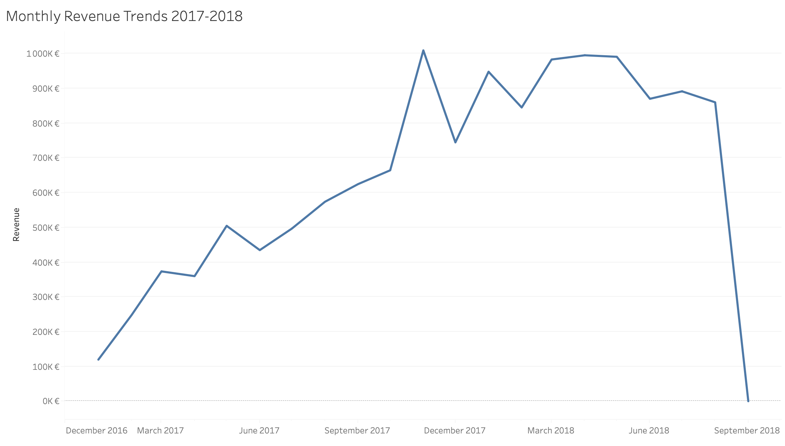
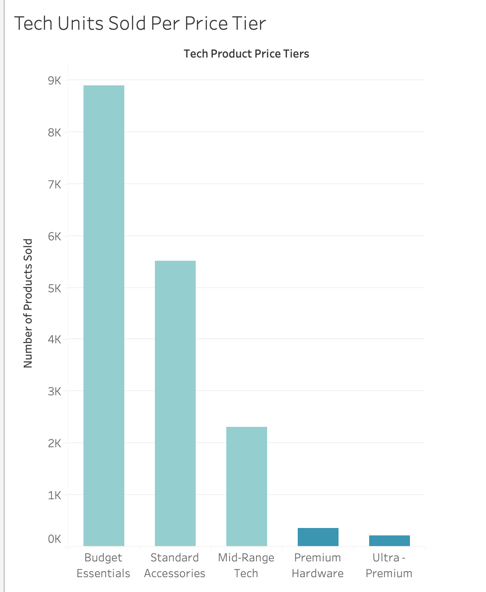
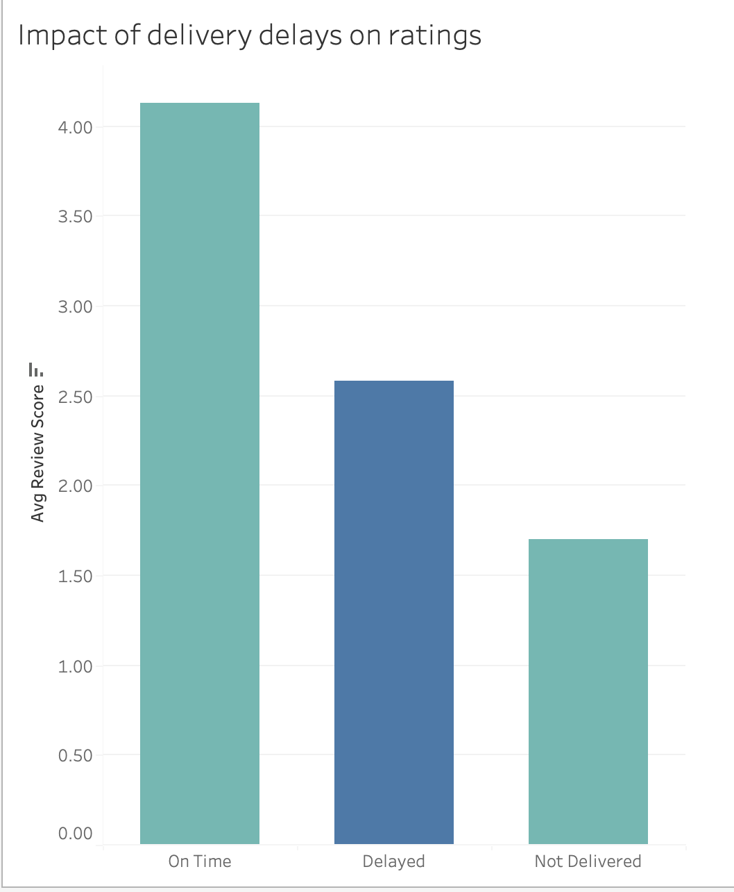
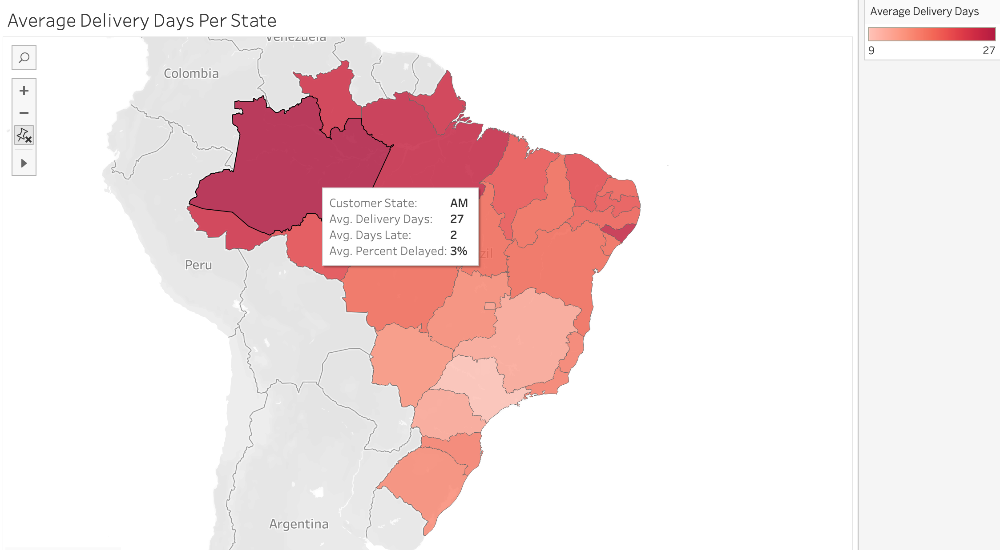

# ENIAC Market Entry: Brazil
### Feasibility assessment of whether ENIAC should enter the Brazilian e-commerce market via Magist.

---

### Contributors: ⚡ Team Electricity

- [**Sweta Khandelwal**](https://github.com/Sweta-Khandelwal)
- [**Asli Ergün**](https://github.com/erguenasli)
- [**Catalina Mayer**](https://github.com/catalinavalenciamayer)

---

## 📦 Deliverables

- 📊 **[Strategic Insights & Recommendations Deck (PDF)](presentation/eniac_magist_presentation.pdf)**
- 📄 **[Complete Findings & Presentation Plan (PDF)](docs/market_entry_feasibility_assessment_magist.pdf)**
- 🗺️ **[Database Schema Diagram (PDF)](docs/magist_schema.pdf)**
- 💻 **[SQL Analysis Script](sql/magist_data_analysis.sql)**
- 📈 **[Tableau Workbooks](tableau/)**
  
---

## 🎯 Project Overview

Created as a group project at **WBS Coding School**, this study investigates the commercial viability of launching Eniac’s premium tech catalog on the Brazilian marketplace Magist. By conducting exploratory data analysis on order fulfillment, delivery times, and product categories, our team assessed potential operational risks and delivered a data-backed recommendation on whether Eniac should proceed with the partnership.

---

### Company Background

* **Eniac:** A Spain-founded online marketplace operating in several European countries, positioning itself as a premier destination for Apple products and curated accessories.
* **Magist:** A Brazilian SaaS company offering a centralized order management system that connects small and medium-sized stores with major Brazilian marketplaces.

---

### Key Stakeholder Questions

Using SQL and exploratory data analysis, our team addressed two critical business concerns:
1. **Product Compatibility:** Does Magist's platform cater to high-end, Apple-compatible tech products?
2. **Delivery Speed:** Does Magist's public Post Office fulfillment network meet Eniac’s standards for fast customer delivery?

---

## 📊 Dataset & Sources

* **Source:** Snapshot of Magist's Dataset provided by [WBS Coding School](https://github.com/WBSCodingSchool) for the case study.
* **Size:** Relational database comprising **~100,000 orders** across **9 interconnected tables** spanning a time period of **2016 to 2018**.
* **Key Features / Variables Used:** 
  * `orders`: Order status, purchase timestamps, delivery dates, and estimated delivery dates.
  * `order_items`: Product ID, seller ID, price, and freight/shipping value.
  * `products`: Product category names, product dimensions, and weight attributes.
  * `order_reviews`: Review score (ratings) and review comments(used to analyze the impact of delivery delays on customer satisfaction).
  * `customers`: Customer city and state locations (zip code prefixes).
* **Data Limitations & Preprocessing Notes:** 
  * **Tech Category Filter:** To align with Eniac's product focus, analysis was filtered to tech-related categories (`computers_accessories`, `computers`, `pc_gamer`, `tablets_printing_image`, `telephony`, `fixed_telephony`, `electronics`, `audio`, `cine_photo`, and `consoles_games`).
  * Product category names were originally in Portuguese and required translation using the provided category translation table.
 
---

### 🚀 Key Findings & Results

* **Significant Market Mismatch:** Magist generated €13.59 million across 2 years, with technology categories representing only 14% (€1.90 million) of gross platform revenue. 
* **The Average Basket Value Disconnect:** Magist's average order price for tech items sits at roughly €124, representing a massive gap compared to ENIAC's typical pricing expectations.
* **High-End Product Deficit & Price Tiers:** Over 82% of all tech sales fall into budget essentials ($\le$€50) and standard accessories (€51–€150), generating €1.3M, while mid-range-to-ultra-premium tiers above €150 account for only €575K.
* **Logistics Volatility & Customer Satisfaction Cliff:** While national delivery averages 13 days, delivery delays severely damage brand perception—dragging customer review scores down from a healthy 4+ stars for on-time deliveries to 2.58 for delayed shipments, and plunging to 1.70 stars for unfulfilled orders. Shipping and delay complaints make up the single largest share of customer grievances (~30%).
* **Macroeconomic Vulnerability:** Magist's revenue trends reveal severe platform plateauing and volatility heading into late 2018, heavily exacerbated by external shocks like Brazil's national truckers' strike and political instability.
* **Strategic Verdict & Recommendation:** A nationwide flagship hardware launch on Magist is a **No-Go** due to high fulfillment risks and low basket sizes; a safer alternative is a phased accessory pilot (€50–€150) strictly restricted to high-density hubs like São Paulo.

---

### 🛠️ Technologies Used

* **Database & Querying:**
  * SQL (MySQL, MySQL Workbench)
* **Visualization & Reporting:**
  * Tableau
* **Presentation & Documentation:**
  * Canva, MS Word

---

### 📁 Project Structure

```text
├── README.md
├── presentation/
│   └── eniac_magist_presentation.pdf                        # Presentation for the case study
├── docs/
│   └── market_entry_feasibility_assessment_magist.pdf       # Document with all the analysis, strategies & verdict
    └── magist_schema.pdf                                    # Database diagram
├── sql/
│   └── magist_data_analysis.sql                             # Queries for analysing the Magist dataset
├── csv/
│   ├── *.csv                                                # All .csv files corresponding to the data analysis
├── tableau/
│   ├── magist_tableau_workbook_part_1.twbx                  # Tableau workbook: Sales, Avg Delay, Order concentration & Monthly revenue analysis 
│   └── magist_tableau_workbook_part_2.twbx                  # Tableau workbook: Price Category, Complaint Categories & Impact of Delivery Delays on Reviews
```

---

## 📈 Visualisations

### Monthly revenue trends


* **Monthly Revenue Trends (2017-2018)**: Illustrates the business's revenue growth trajectory, showing a strong upward trend scaling up towards the 1,000K € peak before a steep drop-off toward late 2018.

### Most tech units sold fall into lower price tiers


* **Tech Units Sold Per Price Tier**: Sales volume is dominated by Budget Essentials (~8.9K units) and Standard Accessories, while higher-tier premium products represent a small fraction of total sales volume.

### Delivery delays heavily impact customer review scores


* **Impact of Delivery Delays on Ratings**: Demonstrates a clear negative correlation between shipping reliability and customer satisfaction. On-time deliveries average a high 4.15/5 rating, whereas delayed or unfulfilled orders cause customer review scores to drop significantly.

### Geographic distribution of delivery delays across states


* **Average Delivery Days Per State**: Highlights regional logistical variations across states. For instance, northern regions experience extended shipping times averaging up to 27 days, pinpointing key fulfillment bottlenecks.

---

## Strategic Recommendations & Alternative Phased Pilot

1. **Enforce Immediate Hardware No-Go:** Reject nationwide distribution of high-end consumer hardware (> €500) via Magist. The low absolute demand volume (< 23 sales/month nationwide) cannot justify Brazilian subsidiary formation, customs clearance and mandatory armed transport escorts.
2. **Execute Phased Accessories Pilot (€50–€150):** If leadership seeks entry into Latin America, initiate a targeted pilot restricted exclusively to **São Paulo State (postal prefixes 0xxxx and 1xxxx)**.
    * Focus on mid-range accessories: Apple-compatible charging stations, multi-port hubs, quality webcams and specialized styluses.
    * Maintain average transit times under 8–9 days within São Paulo to protect brand equity and preserve review ratings above 4.1 stars.
    * Utilize regional fulfillment partners in São Paulo to eliminate the risk of rural last-mile handoffs and cargo security surcharges.

---

## 🛠️ How to Use This Project

1. **Tableau Dashboards**: Explore the interactive visual analyses in the Tableau workbooks located in the [tableau](tableau/) folder ([magist_tableau_workbook_part_1.twbx](tableau/magist_tableau_workbook_part_1.twbx) and [magist_tableau_workbook_part_2.twbx](tableau/magist_tableau_workbook_part_2.twbx)).
2. **Presentation**: Review the final case study findings and slide deck in the [presentation](presentation/) folder ([eniac_magist_presentation.pdf](presentation/eniac_magist_presentation.pdf)).
3. **Data & Queries**: Access the underlying dataset files in [csv](csv/) and review the extraction queries in [magist_data_analysis.sql](sql/magist_data_analysis.sql).
4. **Dependencies**: Requires Tableau Desktop/Reader for interactive visualizations and a standard SQL viewer/workbench.

### 📁 What Files to Look at First

* **[eniac_magist_presentation.pdf](presentation/eniac_magist_presentation.pdf)**: The complete case study presentation summarizing insights, strategic verdicts, and business recommendations.
* **[tableau](tableau/)**: Core Tableau workbooks covering sales trends, delivery delays, price tiers, and complaint categories.
* **[docs](docs/)**: Comprehensive documentation including market entry feasibility assessments and database schemas ([magist_schema.pdf](docs/magist_schema.pdf)).
* **[magist_data_analysis.sql](sql/magist_data_analysis.sql)**: The primary SQL queries used to query the Magist dataset.

---

## 📬 Contact

- **LinkedIn:** [https://linkedin.com/in/khandelwal-sweta](https://linkedin.com/in/khandelwal-sweta])
- **GitHub:** [https://github.com/Sweta-Khandelwal](https://github.com/Sweta-Khandelwal)


